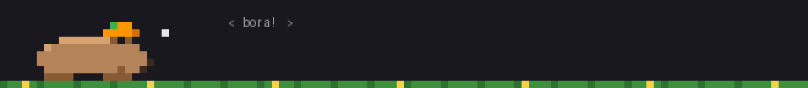
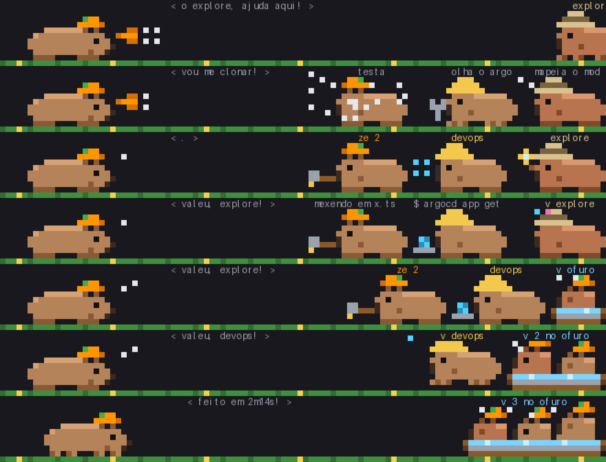
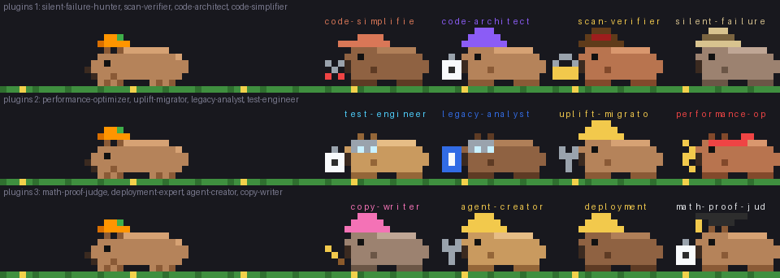

<p align="center">
  
</p>

<h1 align="center">Zé, a capivara do Claude Code</h1>

<p align="center">
  <strong>Seus subagentes viram uma turma de capivaras em pixel art que trabalha bem em cima do seu prompt.</strong>
</p>

<p align="center">
  <a href="LICENSE"></a>
  
  
  <a href="https://github.com/headdira/ze-capibara/actions/workflows/test.yml"></a>
  <a href="https://github.com/headdira/ze-capibara/stargazers"></a>
</p>

<p align="center">
  <a href="README.md">English</a> · <strong>Português</strong>
</p>

O Zé é um mod do Claude Code. Ele mora na faixa acima do prompt e mostra, em pixel art, o que o Claude está fazendo agora. Cada subagente que o Claude chama vira uma capivarinha com o traje do tipo dela. Ela trabalha com o adereço da ferramenta que está usando e, quando termina, vai relaxar no ofurô.

Tudo roda na sua máquina. O Zé não faz nenhuma chamada de rede.

Se o Zé te fez sorrir, uma ⭐ ajuda outras pessoas a encontrar o projeto.

## Cole isto no Claude

Você não precisa ler o resto deste README para começar. Abra um terminal:

```bash
git clone https://github.com/headdira/ze-capibara ~/ze-capibara
cd ~/ze-capibara
claude
```

Com o Claude aberto na pasta, cole este prompt:

```text
Instala o Zé deste repositório no meu Claude Code seguindo o CLAUDE.md.
```

O Claude lê o `CLAUDE.md` do repositório, instala o plugin a partir do clone e confere se deu certo. Depois, abra uma sessão nova e o Zé aparece acima do prompt.

## Instalação manual

Se preferir rodar os comandos você mesmo:

```bash
git clone https://github.com/headdira/ze-capibara ~/ze-capibara
claude plugin marketplace add ~/ze-capibara
claude plugin install ze@ze-capibara
claude plugin list
```

Na saída do `claude plugin list`, procure a linha do Zé:

```text
  ❯ ze@ze-capibara
    Read from: /Users/voce/ze-capibara/ze
    Status: ✔ enabled
```

O `Read from` precisa apontar para a pasta `ze` dentro do seu clone. Abra uma sessão nova do Claude Code e pronto.

**Por que clonar?** O Claude lê o mod direto da pasta do clone. Os bonecos que você criar valem na próxima sessão e não somem quando o plugin atualizar.

### Alternativa rápida, sem customizar

Se você só quer ver o Zé funcionando e não pretende criar bonecos:

```bash
claude plugin marketplace add headdira/ze-capibara
claude plugin install ze@ze-capibara
```

Nesse modo o Claude guarda o plugin num cache interno, e o `claude plugin list` não mostra a linha `Read from`. Qualquer edição que você fizer lá se perde no próximo update. Para customizar, use o clone.

## O que o Zé faz

- Lê arquivo com a lupa, digita no notebook quando roda comando e martela quando edita código.
- Atende o telefone quando o Claude chama um servidor MCP.
- Entra em pânico quando vê um comando perigoso, como `rm -rf` ou `git push --force`.
- Chama a turma: cada subagente chega andando, com traje e nome próprios.
- Comemora quando o turno termina e mostra quanto tempo levou.
- Cai quando uma ferramenta dá erro ou quando você interrompe o turno.
- Esconde senhas e tokens antes de escrever qualquer coisa no balão.

<p align="center">
  
</p>

## Comandos

| Comando | O que faz |
| --- | --- |
| `/ze` | Mostra o que o Zé está fazendo e quem está na turma |
| `/ze pula` | Faz o Zé pular |
| `/ze esconder` | Tira o Zé de cima do prompt |
| `/ze mostrar` | Traz o Zé de volta |

## Prompts prontos

O plugin vem com três skills. Com o Zé instalado, cole um destes pedidos em qualquer sessão do Claude e ajuste do seu jeito:

| Cole no Claude | Skill que resolve |
| --- | --- |
| `Cria um boneco do Zé pro meu agente api-tester com chapéu de cowboy e uma lupa` | `ze:criar-boneco` |
| `Cria um subagente revisor-sql que roda em sonnet e dá um boneco pra ele` | `ze:criar-agente` e `ze:criar-boneco` |
| `Cria uma skill que gera changelog a partir do git log` | `ze:criar-skill` |

A skill de boneco desenha o chapéu e o adereço em pixel art, registra o traje, escreve um teste e roda os testes até ficarem verdes.

## Bonecos

O Zé escolhe o traje de cada capivarinha pelo tipo do subagente, nesta ordem:

1. **Tabela fixa (`TRAJES`).** Tipos com traje próprio, como `explore` (safári), `plan` (boina e prancheta), `general-purpose` (boné) e `fork` (a laranja do Zé).
2. **Palavra no nome (`PALAVRAS`).** Se o tipo não está na tabela, o Zé procura uma palavra conhecida no nome. A primeira regra que casa vence.
3. **Sorteio.** Sem tabela e sem palavra, ela ganha um chapéu sorteado pelo nome. O mesmo nome sempre ganha o mesmo chapéu.

| Se o nome tem | Traje |
| --- | --- |
| `review` | caneta e óculos |
| `secur`, `secret`, `audit`, `scan` | detetive com cadeado |
| `test` | prancheta e óculos |
| `analy`, `extract` | livro e óculos |
| `verif`, `valid`, `judge`, `check` | capelo e prancheta |
| `generat`, `scaffold`, `creat`, `migrat`, `build` | capacete e chave |
| `simplif`, `refactor`, `clean` | boné e tesoura |
| `perf`, `optim` | faixa e raio |
| `deploy`, `devops`, `infra`, `k8s`, `cloud`, `ops` | capacete |
| `explor`, `research`, `search` | safári |
| `architect`, `design`, `plan` | boina e prancheta |
| `math`, `proof` | capelo |
| `doc`, `writ`, `copy`, `market` | boina rosa e lápis |

Então um agente chamado `sql-reviewer` já chega de caneta e óculos, sem você mexer em nada.

<p align="center">
  
</p>

<details>
<summary><strong>Fazer na mão</strong></summary>

Os trajes ficam em `ze/hooks/turma.ts`. Cada desenho é uma lista de strings. Cada letra é uma cor da paleta `PAL` e `.` é transparente.

Este exemplo cria uma cartola e uma lupa, dá as duas para o agente `meu-agente` e veste qualquer agente com `sql`, `banco` ou `dados` no nome.

Em `CHAPEUS`:

```ts
cartola: { arte: ['.PPPP.', '.PPPP.', '.RRRR.', 'PPPPPP'], x: 6, y: -3 },
```

Em `ITENS`:

```ts
lupa: ['.MM', 'MlM', 'MM.', 'h..'],
```

Em `TRAJES`:

```ts
'meu-agente': { rotulo: 'meu', cor: PAL.R!, chapeu: CHAPEUS.cartola, item: ITENS.lupa, oculos: true },
```

No topo de `PALAVRAS`:

```ts
[/sql|banco|dados/, { cor: PAL.u!, chapeu: CHAPEUS.cartola, item: ITENS.lupa }],
```

E um teste em `ze/tests/meu-agente.test.ts`:

```ts
import { expect, test } from 'claude-code/testing'

import { traje } from '../hooks/turma'

test('boneco do meu-agente', () => {
  expect(traje('meu-agente').rotulo).toBe('meu')
  expect(traje('plugin:banco-agent').chapeu?.arte[0]).toBe('.PPPP.')
})
```

Rode `claude plugin test ze` na raiz do clone e abra uma sessão nova para ver.

</details>

## Estrutura do repositório

```text
ze-capibara/
├── .claude-plugin/
│   └── marketplace.json      marketplace "ze-capibara"
├── .github/                  CI de testes e modelos de issue e PR
├── CLAUDE.md                 instruções para o Claude que roda no clone
├── CONTRIBUTING.md           como contribuir
├── README.md                 README em inglês
├── README.pt-BR.md           este README
├── docs/                     imagens do README
└── ze/                       o plugin
    ├── .claude-plugin/
    │   └── plugin.json
    ├── hooks/
    │   ├── hooks.json
    │   ├── register.tsx      eventos do Claude Code e o comando /ze
    │   ├── palco.tsx         a faixa acima do prompt
    │   ├── sprites.ts        o desenho do Zé
    │   ├── turma.ts          as capivarinhas e os trajes
    │   └── fala.ts           pose e balão de cada ferramenta
    ├── skills/
    │   ├── criar-boneco/
    │   ├── criar-agente/
    │   └── criar-skill/
    ├── tests/
    └── types/
```

## Como rodar os testes

Na raiz do clone:

```bash
claude plugin test ze
```

O comando roda todos os `*.test.ts` e `*.test.tsx` de `ze/tests` num ambiente igual ao dos hooks. O CI roda o mesmo comando em cada push e pull request.

## Contribuir

1. Faça um fork do repositório.
2. Crie seu boneco em `ze/hooks/turma.ts` e um teste em `ze/tests/`.
3. Rode `claude plugin test ze` até ficar verde.
4. Abra um pull request com um print da sua capivarinha.

Bonecos novos, trajes para mais palavras e poses para mais ferramentas são bem-vindos. O passo a passo está em [CONTRIBUTING.md](CONTRIBUTING.md). Quer um boneco e não quer desenhar? Abra uma issue com o modelo "New outfit / Novo boneco".

## Licença

[Apache-2.0](LICENSE). Criado por Gerson Moreira.
